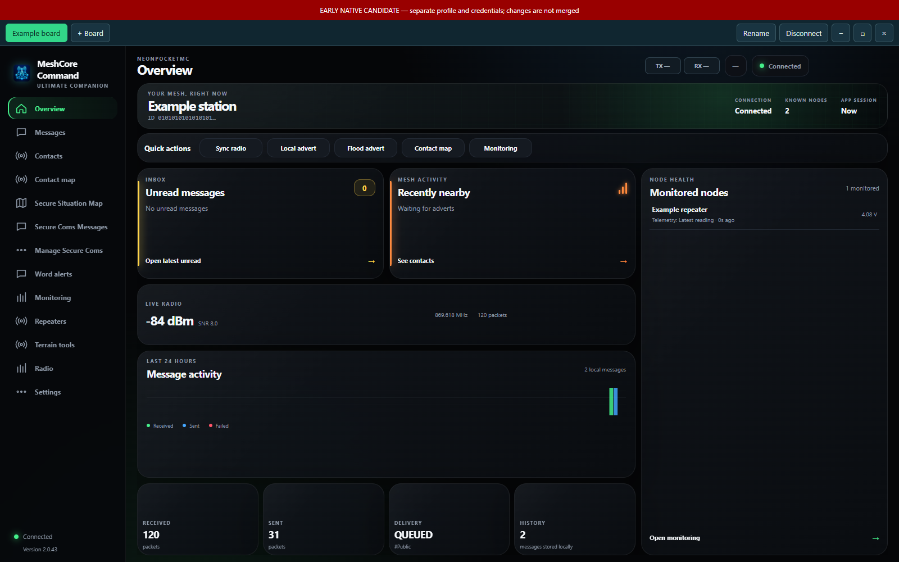
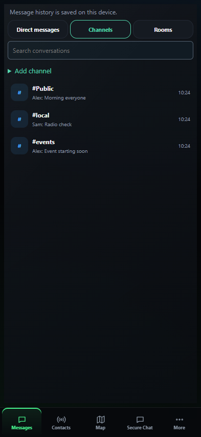
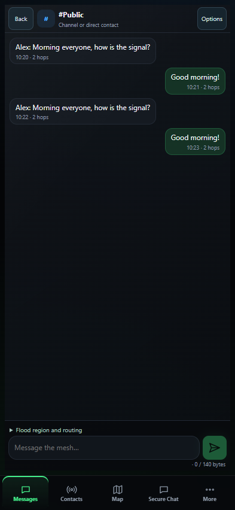
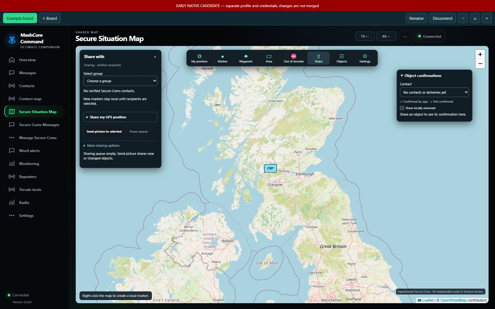
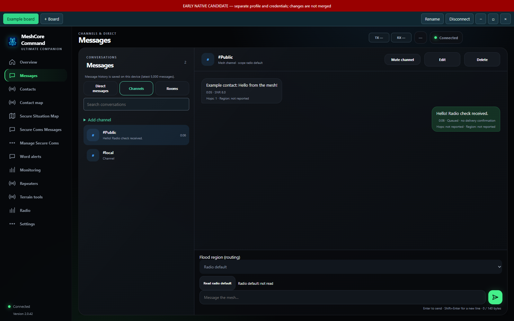
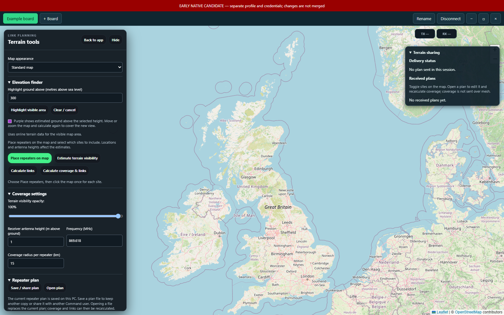
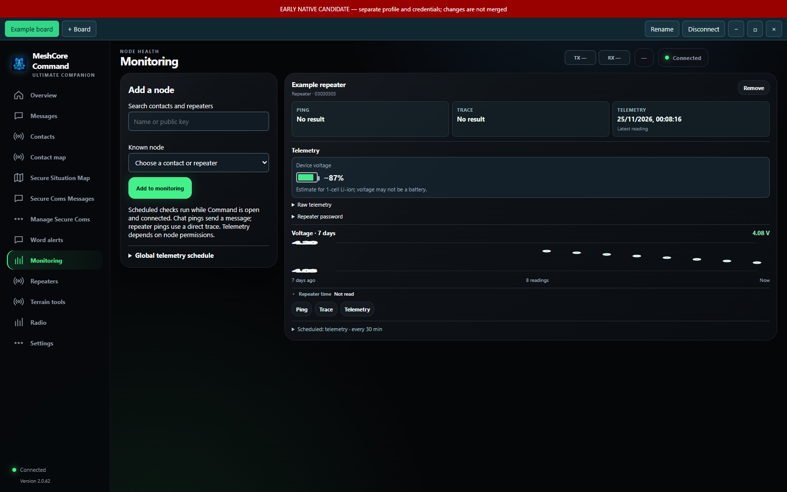

# MeshCore Command

> **Windows release 2.0.63** saves HFLink history and drafts, adds dial frequency controls, and maps contacts with reported Maidenhead locators. [Setup guide](docs/HFLINK.md)

A Windows companion for MeshCore radios, with Wi-Fi, Bluetooth and USB connections, messaging, repeater monitoring, terrain planning and a shared situation map. An experimental Android Bluetooth companion is also included.

The native Windows application is in `MeshCore Windows/`; the previous Python desktop is in `MeshCore Desktop/`. The shared interface and modified companion firmware are in `NeonPocket/`. The firmware tree is based on [NeonPocketMC](https://github.com/n30nex/NeonPocketMC-Heltec-V4) and retains its license files and upstream notices.

## Your mesh, in one place

MeshCore Command brings messaging, radio management and mapping together in a desktop workspace built for MeshCore users.

- **Messages and channels** — chat directly, join channels and communicate with room servers. Search conversations, track unread messages and use word alerts.
- **Secure Coms** — add an AES-256-GCM app-to-app encryption layer to MeshCore direct messages. Exchange messages with verified contacts or send individually to everyone in a local group; compatible Command installations and privately exchanged secrets are required.
- **Secure Situation Map** — use the same Secure Coms protection to share markers, areas and opt-in GPS positions with verified contacts or groups. Track confirmations and retry individual objects. Send waypoints with optional live GPS bearing and distance, and save desktop maps for offline use.
- **Repeater management and monitoring** — search nodes, manage compatible repeaters, view available telemetry and schedule checks. Monitoring cards include a seven-day voltage graph.
- **Terrain and coverage planning** — place planned and known repeater sites, estimate terrain visibility, inspect line-of-sight profiles and share plans with other Command users.
- **Multiple radios** — connect compatible Wi-Fi and Bluetooth companion boards and switch between named board tabs.
- **Setup and recovery** — flash supported Wi-Fi boards, discover radios on your network, reboot the selected local radio, and export an encrypted backup of supported PC and radio data.
- **Android companion** — an experimental Bluetooth app offers messaging, Secure Coms and Situation Map features on Android 12 and newer.

[Download for Windows](#download-for-windows) · [HFLink](#hflink) · [Android test app](#android-test-app) · [Screenshots](docs/SCREENSHOTS.md) · [Windows quick start](docs/NATIVE-TEST-QUICKSTART.md)

Features depend on radio firmware, connectivity and node permissions. Terrain visibility is an estimate, and Secure Coms has not been independently audited. Android and some multi-radio features need further hardware testing.

## HFLink

MeshCore Command starts and configures the JS8Call modem from HFLink. **Inbox** supports directed messages and relay retrieval. **Contacts** lists stations heard by JS8Call and maps reported Maidenhead locators using Command's offline map. **Broadcast** opens a public draft addressed to `@ALLCALL` or a group you choose. **Band activity** shows other decoded traffic, including heartbeats and conversations between other stations. Other stations can use regular JS8Call.

Open **HFLink** once to start listening. **Back to radio** keeps HFLink connected while you work with MeshCore. Choose radio audio, PTT, JS8 speed and the transmit offset in HFLink Settings. The receive waterfall uses the selected radio input. Earlier messages remain available in **Earlier HFLink history**.

[JS8Call setup and relay guide](docs/HFLINK.md) · [HFLink guide for Windows 2.0.59](https://github.com/Nortag82/MeshCore-Command/blob/v2.0.59/docs/HFLINK.md)

The [JS8-R Windows receive preview](https://github.com/Nortag82/MeshCore-Command/releases/tag/v2.0.64-js8-r.1) bundles the headless decoder for **HFLink → HF Lab**. See the [JS8-R development notes](docs/js8-r/ARCHITECTURE.md) for the remaining modem and protocol work.

## How Secure Coms protects messages and maps

MeshCore already encrypts direct messages. Secure Coms adds a second, independent **AES-256-GCM** layer in the Command apps: the sender encrypts the content before passing it to the companion radio, and the receiving Command app decrypts it using the shared secret. Secure Situation Map updates, including shared markers, areas and GPS positions, use the same app-to-app transport. Ordinary channel and direct messages are not automatically covered by this additional layer. See [MeshCore's payload documentation](https://github.com/meshcore-dev/MeshCore/blob/main/docs/payloads.md) for the underlying packet formats.

This extra layer protects the contents of secure messages and map updates from a party that can access the MeshCore transport but does not have the Command shared secret. GCM also checks integrity: a modified or unauthenticated secure payload is rejected. Each pair must exchange a randomly generated secret privately and compare the displayed fingerprint through a trusted channel. Compatible Command installations are required at both ends; a standard MeshCore app can display the encrypted `MC1.` payload as text but cannot open it.

There are tradeoffs. Packet routing information and traffic patterns remain observable; ordinary adverts and Public-channel discovery can reveal identifying information. Encryption adds overhead, limiting each secure message to **74 UTF-8 bytes**. A local group sends a separate encrypted message to each member, increasing airtime and delivery time. A radio acknowledgement is not proof the other app decrypted or read a message. **The implementation has not been independently audited and does not provide forward secrecy**: someone who obtains a shared secret may be able to decrypt previously recorded traffic. It also cannot protect plaintext on a compromised endpoint. For key handling, replay protection, map storage and recovery details, see [Secure Coms security and tradeoffs](docs/SECURE-COMS-SECURITY.md).

## Download for Windows

Download the [version 2.0.63 Windows installer](https://github.com/Nortag82/MeshCore-Command/releases/tag/v2.0.63) or update from **Settings** in the native app. The legacy Python updater can offer the [2.0.43 migration release](https://github.com/Nortag82/MeshCore-Command/releases/tag/v2.0.43). Back up important data first and see the [Windows quick start](docs/NATIVE-TEST-QUICKSTART.md) and [upgrade notes](MeshCore%20Windows/LEGACY-UPGRADE.md). The Python and native apps keep separate profiles. Setup checks for WebView2 and offers to install it from Microsoft if needed. The installer and bundled firmware are unsigned. Use the exact board option and back up radio data before flashing.

## Android test app

The experimental [Android source and setup instructions](Android/README.md) target Android 12 and newer and connect over Bluetooth to standard MeshCore BLE companion firmware. The phone interface includes messaging, Secure Coms, the Secure Situation Map and selected Command tools. Secure message and map compatibility, Bluetooth pairing, and radio operations still require testing on physical devices. Map tiles require internet and receiving while the app is closed is not supported. Download the experimental [Android 0.2.15 APK](https://github.com/Nortag82/MeshCore-Command/releases/tag/v2.0.38) from the test release.

These previews use the interface from the released Android 0.2.15 APK with simulated conversations and a simulated radio bridge:

 

## A look inside

[See the Windows screenshots](docs/SCREENSHOTS.md), including the board selector and main navigation pages.

> Screenshots use simulated contacts, messages, telemetry and map markers. Map data © OpenStreetMap contributors.

### Secure Situation Map

Build a shared picture using markers, civilian and emergency icons, and drawn areas. The floating toolbar provides marker, area, sharing and map controls; right-click to create or edit a marker. To move it, select it, choose **Move selected marker**, click the new position and save. Markers cannot be dragged. Markers can be saved locally, even before you add a secure contact.

Share marker and area updates with selected verified Secure Coms contacts or local groups. Full-picture sharing targets selected recipients; forwarding received markers is separately opt-in. The app shows which marker updates the receiving app has confirmed saving. Both users need compatible MeshCore Command installations and a connected radio. Sharing uses the experimental Secure Coms protocol; it has not been independently audited and does not provide forward secrecy. It is not ATAK compatible.

The sharing queue supports retries, pause and resume, and per-recipient incremental picture sharing. You can retry one unconfirmed object, force a full picture, or remove a pending deletion from your local lists. TX/RX indicators summarise observed radio activity.

### Find other Command users

In **Manage Secure Coms**, use **Discover Command installs** to send a discovery request on the Public channel using the radio's default flood scope. Other compatible, running Command installations can respond. Responses announce their public key and app presence, and automatic responses can be turned off. Discovery replies are unverified and can be spoofed: exchange a secret privately and compare fingerprints before trusting a contact. Other MeshCore apps may display discovery traffic as ordinary channel messages.

### Offline maps

Open **Settings** on the Situation map, select two corners of an area, choose a detail level and download it for later use without internet. You can also import a Protomaps PMTiles map or a raster MBTiles map. Map downloads require internet and use local disk space; terrain coverage tools need separate online elevation data.

See the [screenshot gallery](docs/SCREENSHOTS.md) for the current map controls.

### Overview
See radio status, recent activity, monitored nodes and quick actions in one place.

### Messages
Switch between direct messages, channels and rooms; unread counts show which tabs and conversations have new messages. Choose a flood scope for a channel.

The TX and RX indicators summarize observed activity; they do not show continuous radio airtime.

### Elevation finder

In **Terrain tools**, enter a height above sea level to highlight terrain above that threshold across the visible map. The result uses online Mapzen terrain tiles and is an estimate; its displayed resolution and the underlying source data limit the detail. Move or zoom the map and recalculate for the new view.

### Monitoring
Schedule checks and review the latest available measurements for contacts and repeaters.

## User manual

Read the [MeshCore Command user manual](docs/USER-MANUAL.md) for setup, messaging, repeater management, mapping and troubleshooting.

## Building

The native Windows app uses .NET 10 and WebView2. Its build bundles the shared interface with Node.js; see the [native build notes](MeshCore%20Windows/README.md) for firmware staging, testing and packaging. The previous Python desktop uses pywebview, pyserial, esptool and PyInstaller. Generated firmware binaries and local device data are not included. Firmware targets and packaging must be verified before distributing builds.

Do not commit Wi-Fi credentials, radio identity backups, message histories or private keys.

Version history and technical notes

The current Windows release is **2.0.63**. The previous Python release is **2.0.38** and the Android test build is **0.2.15**. Secure groups use local recipient lists to send individual encrypted messages. The [secure pairing research prototype](experimental/secure-pairing/) is separate. Command discovery uses Public.

Windows 2.0.6 and newer add a user-initiated update check. Release publishers must name future Windows assets `MeshCore-Command-Windows-X.Y.Z-Setup.exe`, retain the installer's `--update` mode, and publish the asset with GitHub's SHA-256 digest. The app compares that digest before launching the installer; the digest is not an independent signature.

Windows 2.0.21 adds an inbox and unread alerts for received terrain plans, compact map telemetry graphs, automatic recalculation after moving a repeater, and map-linked elevation profiles. Terrain visibility now uses selected repeater sites without requiring Point A. These changes were tested with simulations. Windows 2.0.20 adds encrypted terrain-plan transfer with per-packet acknowledgements, compact repeater telemetry, streamlined terrain controls and a repeater location map picker. Both Command installations need this version for plan transfer; testing used simulated radios, not physical LoRa hardware. Windows 2.0.19 adds saveable and shareable terrain plans and restores red for terrain blocked from all enabled repeaters. Windows 2.0.18 adds a blinking indicator for received Secure Situation Map markers and a multi-repeater terrain planner with individual link profiles. Terrain results are estimates, not signal-strength measurements. Windows 2.0.17 checks for updates at startup and asks before installing. Windows 2.0.16 combines Secure Coms with the encrypted PC and radio backup; the unified import also accepts older Secure Coms backup files. Windows 2.0.15 can include the connected radio’s identity, contacts, channels and supported settings in the encrypted full backup. Restore PC data and the connected radio separately from the same file. Wi-Fi credentials, radio message queues, companion repeat mode and some firmware-specific settings are not included. Private identity export/import must be supported by the firmware. Windows 2.0.14 adds a map picker directly to the location settings. Windows 2.0.13 added a map-based radio location control, a global telemetry schedule, automatic inactive-contact replacement, and an encrypted full PC backup. These features have been tested with simulations and need further testing with physical radios. The backup includes local secrets and offline maps up to 256 MB, but excludes Wi-Fi credentials and some firmware-specific radio settings; restoring an older backup can roll back Secure Coms replay records. Windows 2.0.9 adds a seven-day device-voltage graph to each monitored repeater, based on telemetry readings stored locally while the app is connected. Windows 2.0.5 adds Wi-Fi reconnect and startup crash mitigations. Windows 2.0.8 reports local message-history storage failures and preserves pending history if a save fails. The bundled Heltec V4 automatic display/headless PC Wi-Fi firmware disables new on-radio message-journal records; it must be flashed separately, existing journal files are not erased, and other bundled board variants are unchanged. The V4 build has not yet been tested on physical hardware. The reconnect code retries a dropped network connection without automatically retransmitting uncertain messages. The startup loading window runs separately from the main app to isolate Tcl/Tk faults. These changes need further testing with real radios.

Version 2.0.3 removes Secure Images and image transfers. Secure Situation Map picture sharing remains available.

Version 2.0.2 adds an opt-in control for MeshCore's off-grid companion-repeat mode. The app checks the radio's permitted frequency list and does not change frequency automatically. UK Narrow (869.618 MHz) is not allowed by the bundled firmware's default companion-repeat list. See the [manual](docs/USER-MANUAL.md#off-grid-companion-repeat).

See the radio settings in the [screenshot gallery](docs/SCREENSHOTS.md).

Windows 2.0.27 reorganises repeater management around a searchable node list and dedicated settings, regions, neighbours and console views. Windows 2.0.25 adds simultaneous Wi-Fi and Bluetooth companion tabs, unread message indicators for inactive boards, terrain-plan delivery status and received-site layers, and contact/group selection when creating situation markers. A Wi-Fi and BLE radio were connected together in a local Windows test; longer-term use and complete radio functionality require further testing. Received terrain plans contain sites and settings; calculate coverage locally. Android 0.2.2 includes the marker recipient controls, while terrain planning remains Windows-only.

