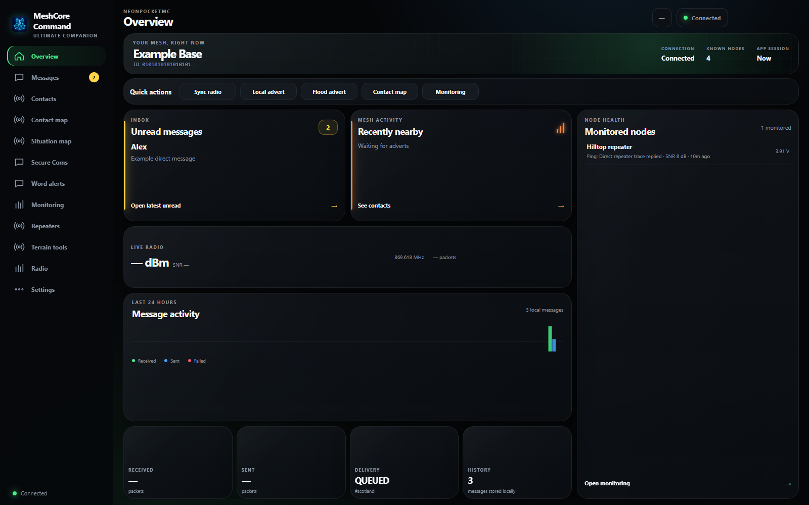
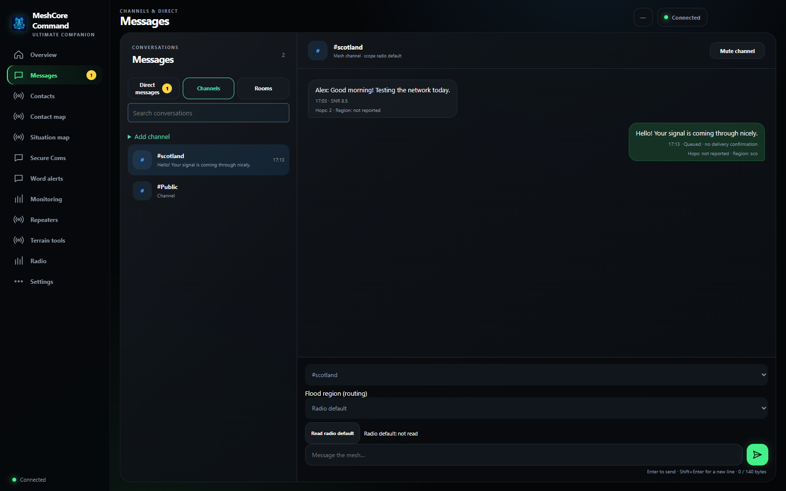
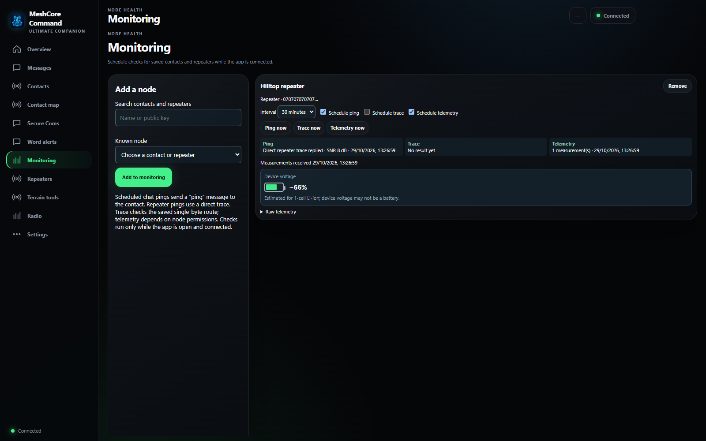

# MeshCore Command

A Windows desktop companion for controlling a Wi-Fi connected MeshCore radio, with messaging, contacts, repeater management, monitoring and terrain planning.

This repository contains the desktop source in `MeshCore Desktop/` and the modified companion firmware and interface sources in `NeonPocket/`. The firmware tree is based on [NeonPocketMC](https://github.com/n30nex/NeonPocketMC-Heltec-V4) and retains its license files and upstream notices. See [desktop documentation](MeshCore%20Desktop/README.md) for features and device support.

## Download for Windows

Download [Install MeshCore Command.exe](https://github.com/Nortag82/MeshCore-Command/raw/refs/heads/main/downloads/Install%20MeshCore%20Command.exe) and see the [user manual](docs/USER-MANUAL.md). Verify the download with [SHA256SUMS.txt](downloads/SHA256SUMS.txt). Windows Edge WebView2 is required. The installer and bundled firmware are unsigned and experimental; use the exact board option and back up important radio data before flashing.

## A look inside

> Screenshots use simulated contacts, messages and telemetry.

### Overview
See radio status, recent activity, monitored nodes and quick actions in one place.

### Messages
Switch between direct messages, channels and rooms; choose a flood scope for a channel.

### Monitoring
Schedule checks and review the latest available measurements for contacts and repeaters.

## User manual

Read the [MeshCore Command user manual](docs/USER-MANUAL.md) for setup, messaging, repeater management, mapping and troubleshooting.

## Building

The desktop app uses Python, pywebview, pyserial, esptool and PyInstaller. The radio interface is built with Node.js from `NeonPocket/examples/companion_radio/webui`, then `MeshCore Desktop/build_radio.py` creates `radio.html`. The flasher and packaged installer additionally require board-specific compiled firmware, a firmware manifest and a separately built flash-helper executable. Those generated binaries and local device data are not included. Firmware targets and packaging must be verified before distributing builds.

Do not commit Wi-Fi credentials, radio identity backups, message histories or private keys.
