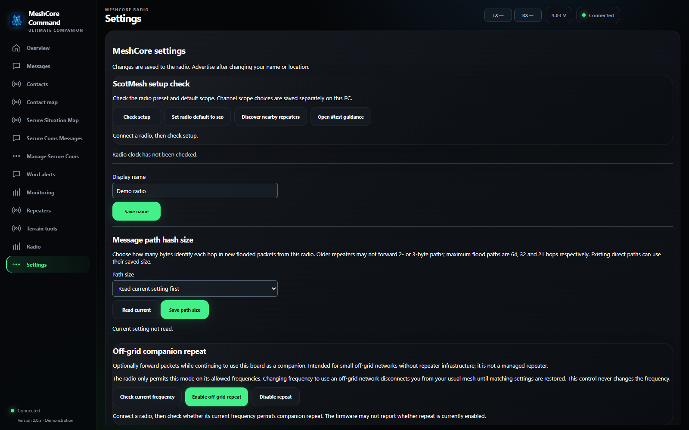
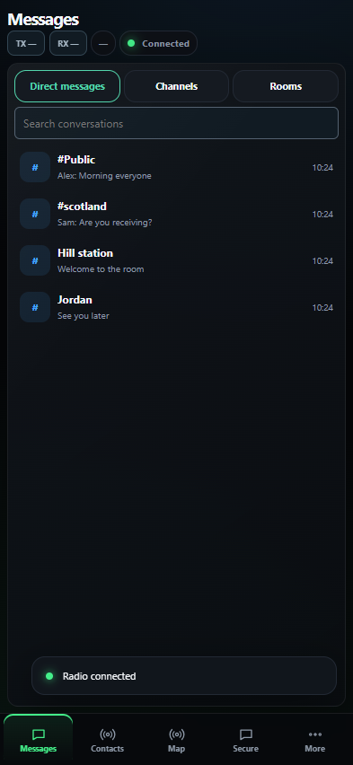
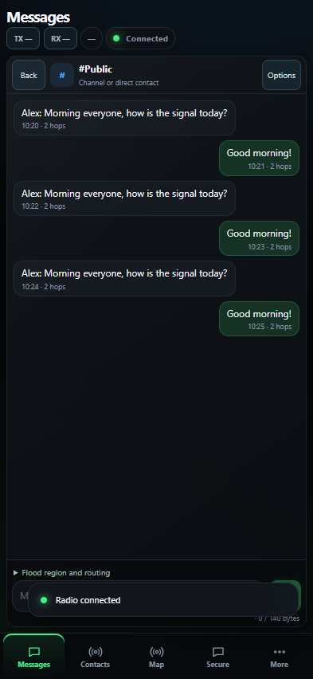
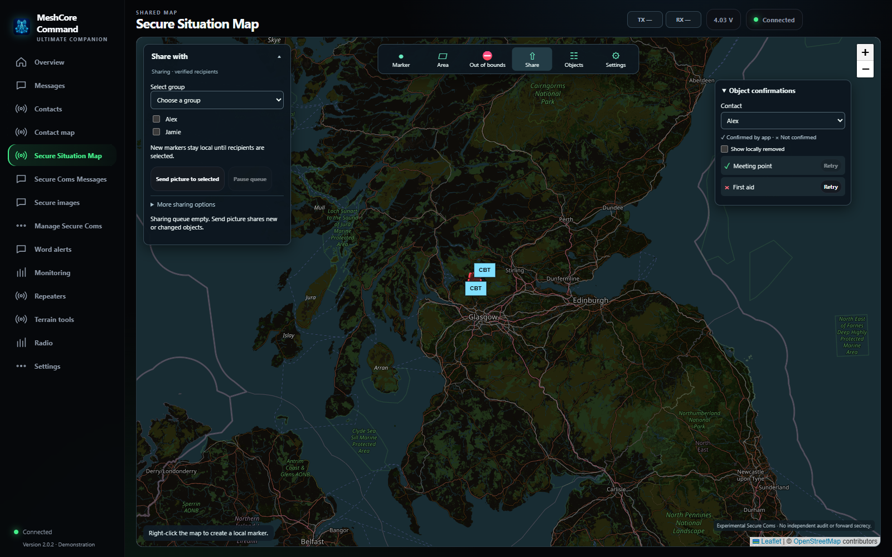
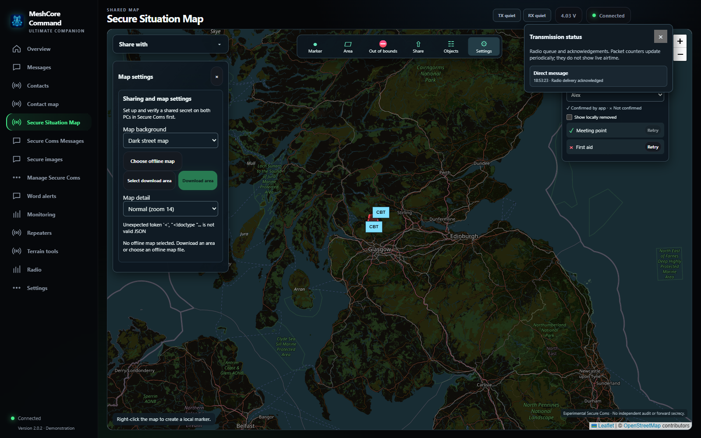
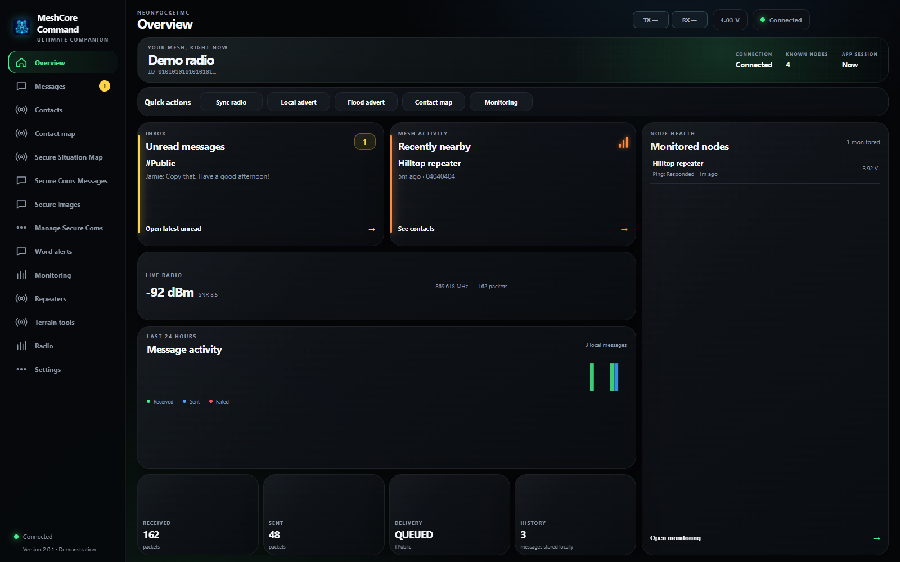
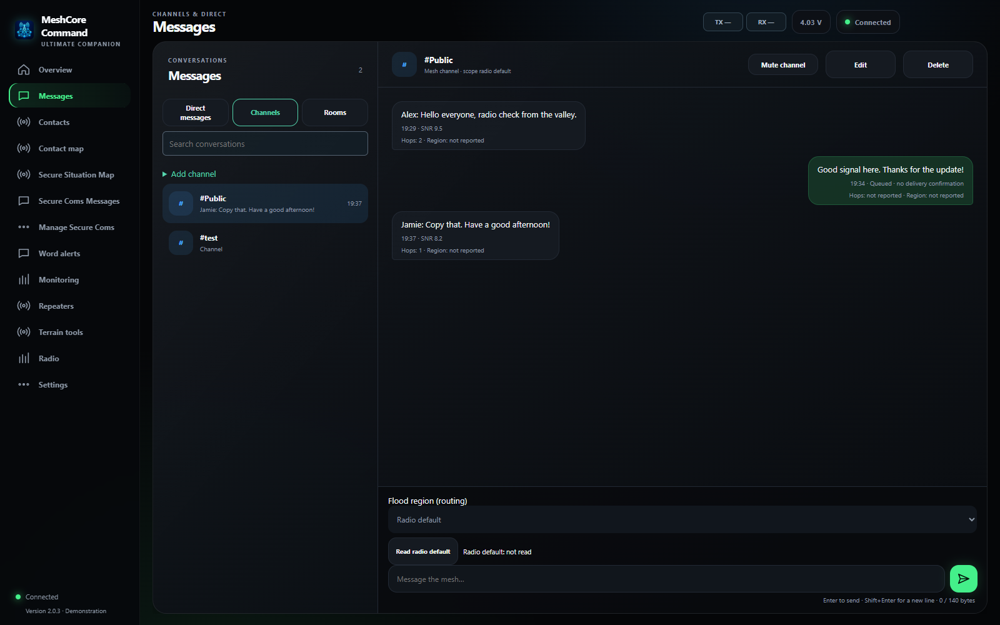
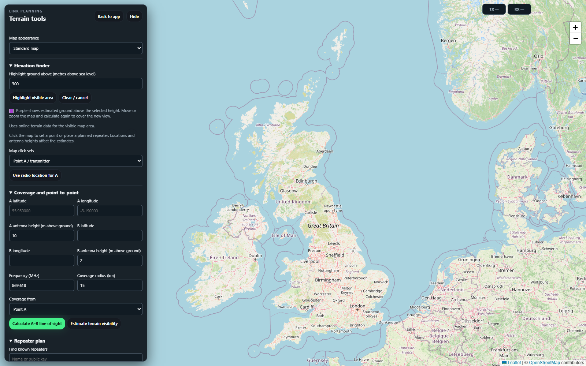
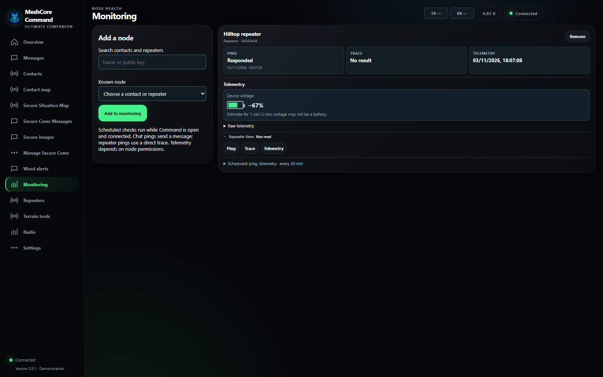

# MeshCore Command

A Windows desktop companion for controlling a Wi-Fi connected MeshCore radio, with messaging, contacts, repeater management, monitoring, terrain planning and a shared situation map with offline basemaps. An experimental Android Bluetooth companion is also included.

This repository contains the desktop source in `MeshCore Desktop/` and the modified companion firmware and interface sources in `NeonPocket/`. The firmware tree is based on [NeonPocketMC](https://github.com/n30nex/NeonPocketMC-Heltec-V4) and retains its license files and upstream notices. See [desktop documentation](MeshCore%20Desktop/README.md) for features and device support.

The current test release is **2.0.16** for Windows and **0.2.1** for Android. Secure groups are local recipient lists that send individual encrypted messages; no group key is needed. The separate [secure pairing research prototype](experimental/secure-pairing/) is not integrated. Command discovery still uses Public.

Windows 2.0.6 and newer add a user-initiated update check. Release publishers must name future Windows assets `MeshCore-Command-Windows-X.Y.Z-Setup.exe`, retain the installer's `--update` mode, and publish the asset with GitHub's SHA-256 digest. The app compares that digest before launching the installer; the digest is not an independent signature.

Windows 2.0.16 combines Secure Coms with the encrypted PC and radio backup; the unified import also accepts older Secure Coms backup files. Windows 2.0.15 can include the connected radio’s identity, contacts, channels and supported settings in the encrypted full backup. Restore PC data and the connected radio separately from the same file. Wi-Fi credentials, radio message queues, companion repeat mode and some firmware-specific settings are not included. Private identity export/import must be supported by the firmware. Windows 2.0.14 adds a map picker directly to the location settings. Windows 2.0.13 added a map-based radio location control, a global telemetry schedule, automatic inactive-contact replacement, and an encrypted full PC backup. These features have been tested with simulations and need further testing with physical radios. The backup includes local secrets and offline maps up to 256 MB, but excludes Wi-Fi credentials and some firmware-specific radio settings; restoring an older backup can roll back Secure Coms replay records. Windows 2.0.9 adds a seven-day device-voltage graph to each monitored repeater, based on telemetry readings stored locally while the app is connected. Windows 2.0.5 adds Wi-Fi reconnect and startup crash mitigations. Windows 2.0.8 reports local message-history storage failures and preserves pending history if a save fails. The bundled Heltec V4 automatic display/headless PC Wi-Fi firmware disables new on-radio message-journal records; it must be flashed separately, existing journal files are not erased, and other bundled board variants are unchanged. The V4 build has not yet been tested on physical hardware. The reconnect code retries a dropped network connection without automatically retransmitting uncertain messages. The startup loading window runs separately from the main app to isolate Tcl/Tk faults. These changes need further testing with real radios.

Version 2.0.3 removes Secure Images and image transfers. Secure Situation Map picture sharing remains available.

Version 2.0.2 adds an opt-in control for MeshCore's off-grid companion-repeat mode. The app checks the radio's permitted frequency list and does not change frequency automatically. UK Narrow (869.618 MHz) is not allowed by the bundled firmware's default companion-repeat list. See the [manual](docs/USER-MANUAL.md#off-grid-companion-repeat).

## Download for Windows

Download the [version 2.0.16 Windows installer](https://github.com/Nortag82/MeshCore-Command/releases/tag/v2.0.16), then follow the [user manual](docs/USER-MANUAL.md). The release page lists the installer checksum. Windows Edge WebView2 is required. The installer and bundled firmware are unsigned and experimental; use the exact board option and back up important radio data before flashing.

## Android test app

The experimental [Android source and setup instructions](Android/README.md) target Android 12 and newer and connect over Bluetooth to standard MeshCore BLE companion firmware. The phone interface includes messaging, Secure Coms, the Secure Situation Map and selected Command tools. Secure message and map compatibility, Bluetooth pairing, and radio operations still require testing on physical devices. Map tiles require internet and receiving while the app is closed is not supported. Download the experimental [Android 0.2.1 APK](https://github.com/Nortag82/MeshCore-Command/releases/tag/v2.0.5) from the test release.

These phone previews use simulated conversations and a simulated radio connection:

 

## A look inside

[See screenshots of every menu](docs/SCREENSHOTS.md), including connection and firmware setup.

> Screenshots use simulated contacts, messages, telemetry and map markers. Map data © OpenStreetMap contributors.

### Secure Situation Map

Build a shared picture using markers, civilian and emergency icons, and drawn areas. The floating toolbar provides marker, area, sharing and map controls; right-click to create or edit a marker. To move it, select it, choose **Move selected marker**, click the new position and save. Markers cannot be dragged. Markers can be saved locally, even before you add a secure contact.

Share marker and area updates with selected verified Secure Coms contacts or local groups. Full-picture sharing targets selected recipients; forwarding received markers is separately opt-in. The app shows which marker updates the receiving app has confirmed saving. Both users need compatible MeshCore Command installations and a connected radio. Sharing uses the experimental Secure Coms protocol; it has not been independently audited and does not provide forward secrecy. It is not ATAK compatible.

Version 2.0 adds a persistent sharing queue with automatic retries, pause and resume, and per-recipient incremental picture sharing. You can retry one unconfirmed object, force a full picture, or remove a pending deletion from your local lists. TX/RX indicators and a transmission activity view help you follow radio activity.

### Find other Command users

In **Manage Secure Coms**, use **Discover Command installs** to send a discovery request on the Public channel using the radio's default flood scope. Other compatible, running Command installations can respond. Responses announce their public key and app presence, and automatic responses can be turned off. Discovery replies are unverified and can be spoofed: exchange a secret privately and compare fingerprints before trusting a contact. Other MeshCore apps may display discovery traffic as ordinary channel messages.

### Offline maps

Open **Settings** on the Situation map, select two corners of an area, choose a detail level and download it for later use without internet. You can also import a Protomaps PMTiles map or a raster MBTiles map. Map downloads require internet and use local disk space; terrain coverage tools need separate online elevation data.

### Overview
See radio status, recent activity, monitored nodes and quick actions in one place.

### Messages
Switch between direct messages, channels and rooms; unread counts show which tabs and conversations have new messages. Choose a flood scope for a channel.

The TX and RX indicators summarize observed activity; they do not show continuous radio airtime.

### Elevation finder

In **Terrain tools**, enter a height above sea level to highlight terrain above that threshold across the visible map. The result uses online Mapzen terrain tiles and is an estimate; its displayed resolution and the underlying source data limit the detail. Move or zoom the map and recalculate for the new view.

### Monitoring
Schedule checks and review the latest available measurements for contacts and repeaters.

## User manual

Read the [MeshCore Command user manual](docs/USER-MANUAL.md) for setup, messaging, repeater management, mapping and troubleshooting.

## Building

The desktop app uses Python, pywebview, pyserial, esptool and PyInstaller. The radio interface is built with Node.js from `NeonPocket/examples/companion_radio/webui`, then `MeshCore Desktop/build_radio.py` creates `radio.html`. The flasher and packaged installer additionally require board-specific compiled firmware, a firmware manifest and a separately built flash-helper executable. Those generated binaries and local device data are not included. Firmware targets and packaging must be verified before distributing builds.

Do not commit Wi-Fi credentials, radio identity backups, message histories or private keys.
