# MeshCore Command screenshots

Screens show simulated contacts, messages, addresses and map markers. Map data © OpenStreetMap contributors.

## Connect

Connect to a saved radio or find one on your network.

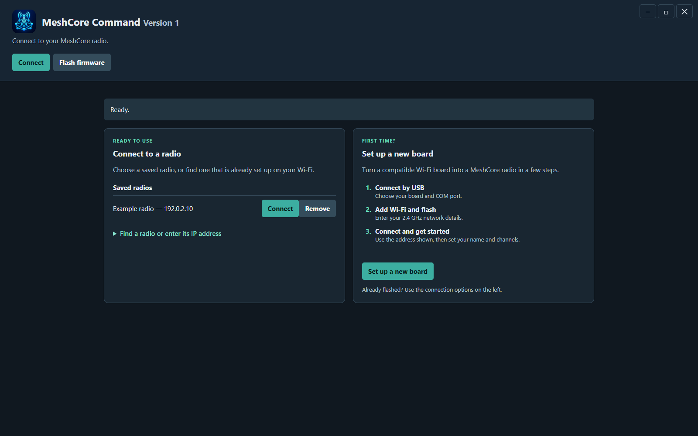

## Flash firmware

Select a board to see USB and boot instructions.

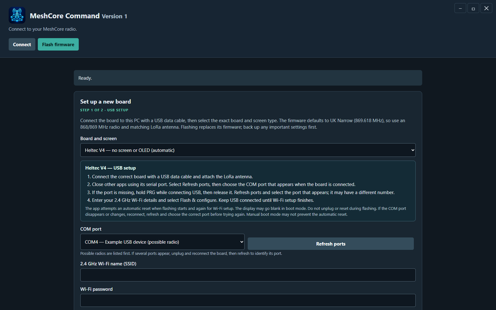

## Overview

Review radio activity and quick actions.

## Messages

Read direct, channel and room conversations with unread indicators.

## Contacts

Search known nodes and use contact tools.

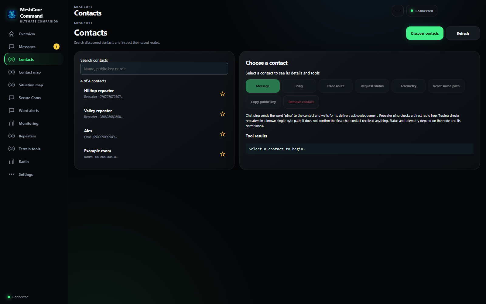

## Contact map

View known locations and packet information.

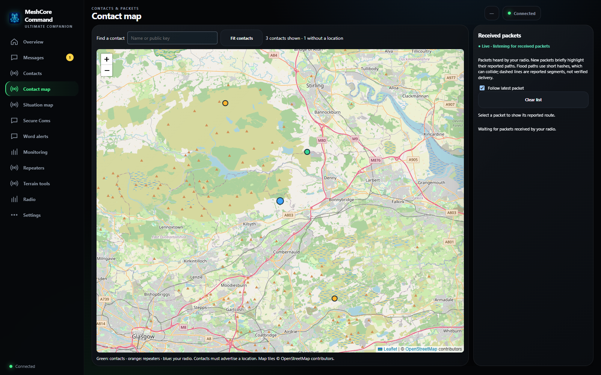

## Situation map

Create and share map markers.

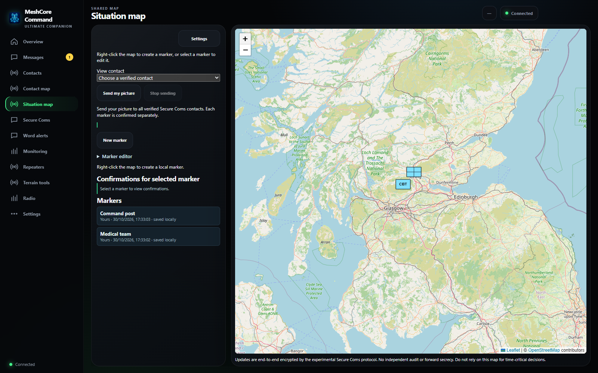

## Secure Coms

Set up encrypted contacts and discover compatible installations.

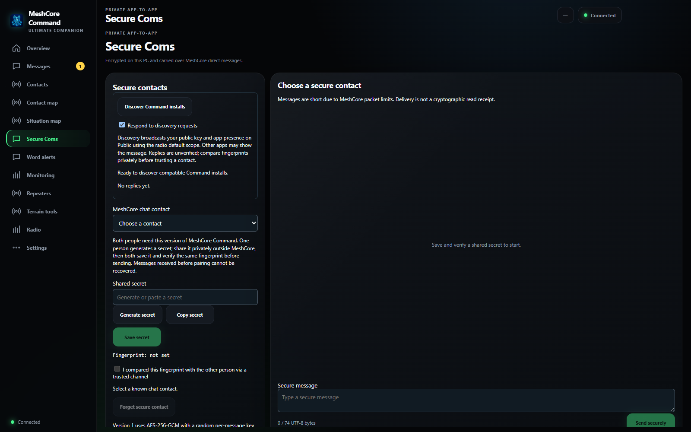

## Word alerts

Configure message word alerts.

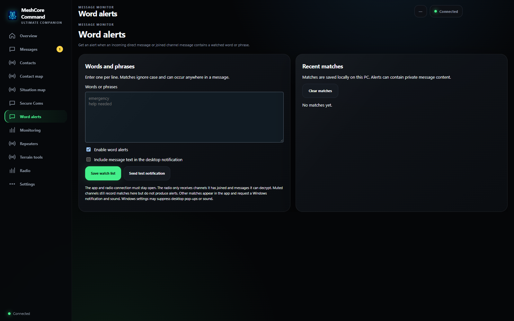

## Monitoring

Review scheduled checks and available telemetry.

## Repeaters

Control repeaters and review neighbour links.

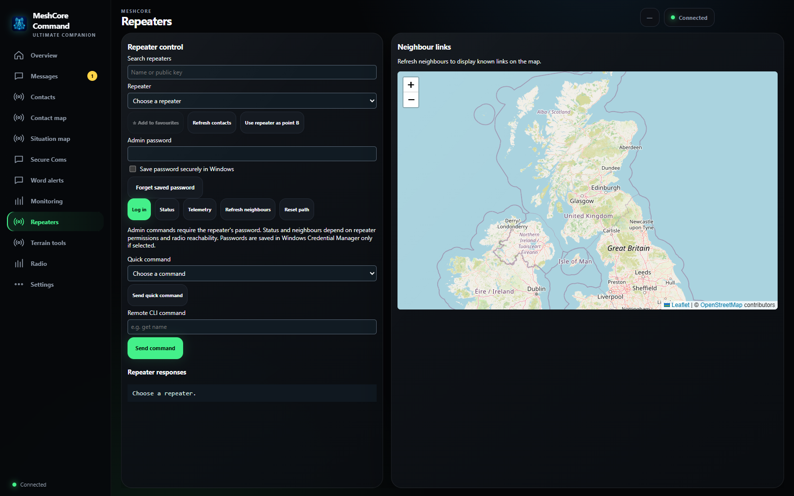

## Terrain tools

Plan links and estimate terrain visibility.

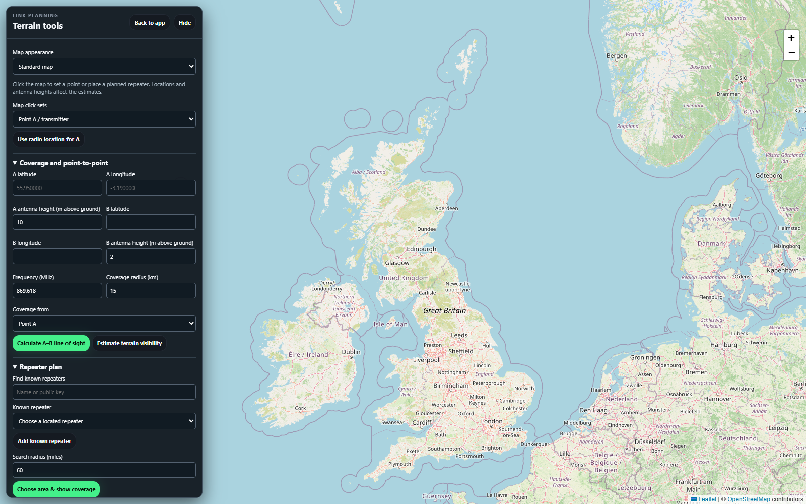

## Radio

Review radio information and activity.

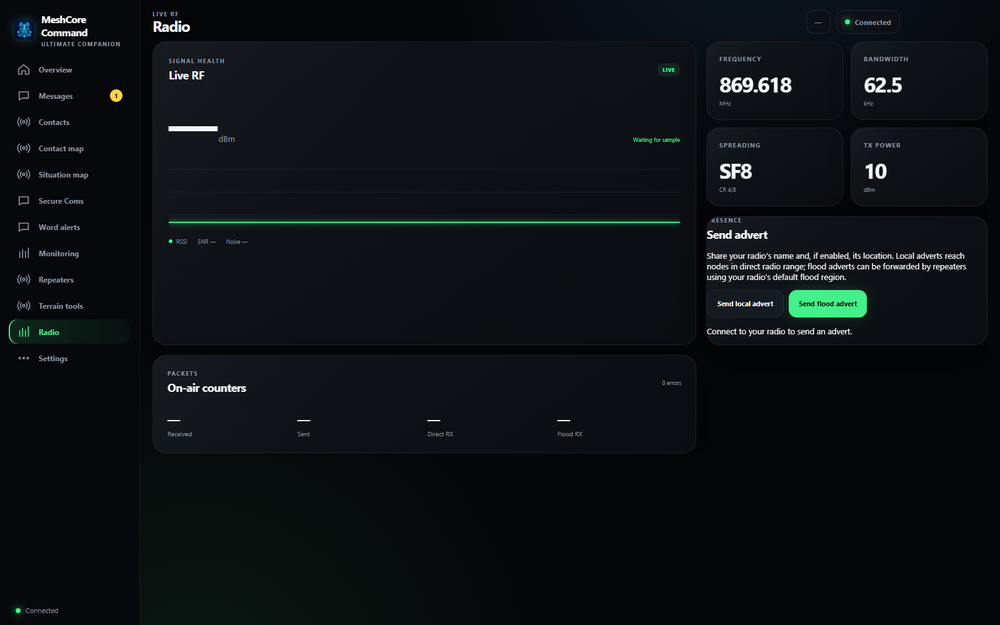

## Settings

Configure radio and MeshCore settings.

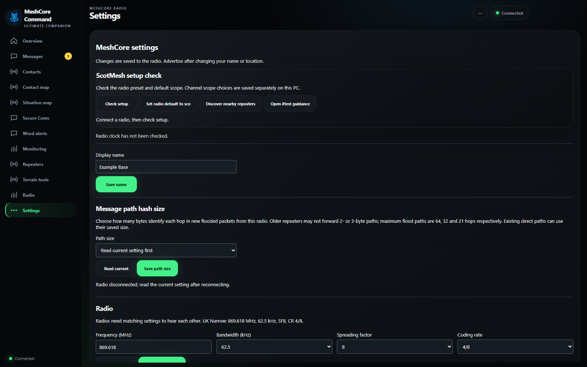
