# MeshCore Command screenshots

The session status image shows HFLink in Windows 2.0.53. The waterfall image shows 2.0.49, the other HFLink images show 2.0.48, and the remaining Windows images show 2.0.43. The captures use simulated signals, contacts, messages, telemetry and map objects. Map data © OpenStreetMap contributors.

The native firmware dialog is not pictured here. The Android images in the README use the HTML from the released Android 0.2.15 APK with a simulated bridge; they are not photographs of a phone or live radio session.

## HFLink in earlier Mercury-based releases

The right-hand panel shows the session stage and modem reports as they arrive. This simulated receive has saved a message and is waiting for receipt approval.

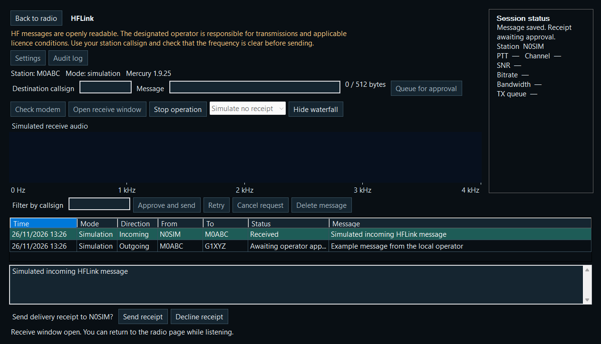

Select **Show waterfall** to see audio in the tuned receive passband. The example shows simulated signals.

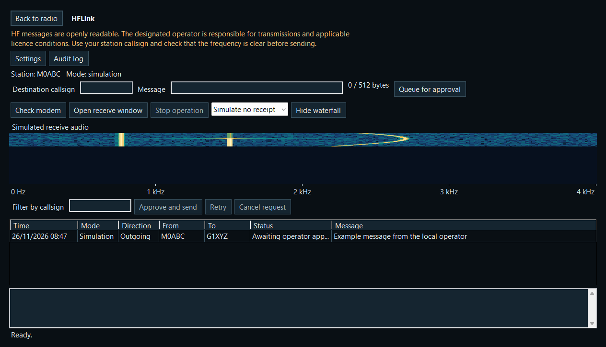

HFLink has one **Settings** button for the station, audio and PTT, and firewall. With a receive window open, you can return to the radio page and get notified when a message arrives.

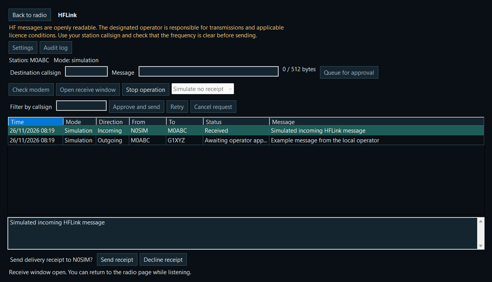

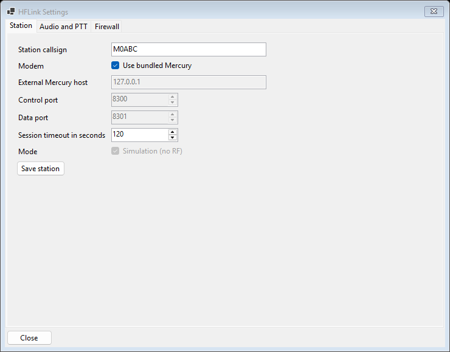

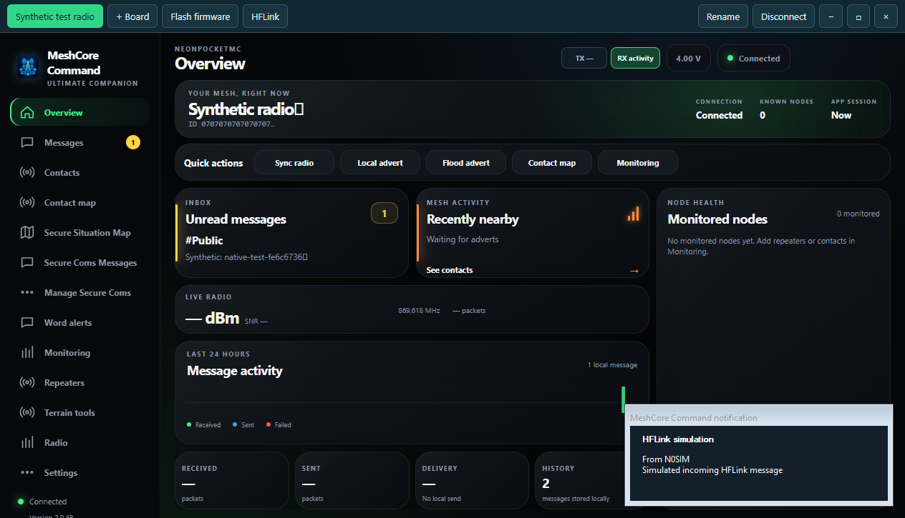

## Saved Wi-Fi boards

Choose a saved board and connect beneath the list. Removing one requires confirmation.

## Overview

Radio status, recent activity and monitored nodes.

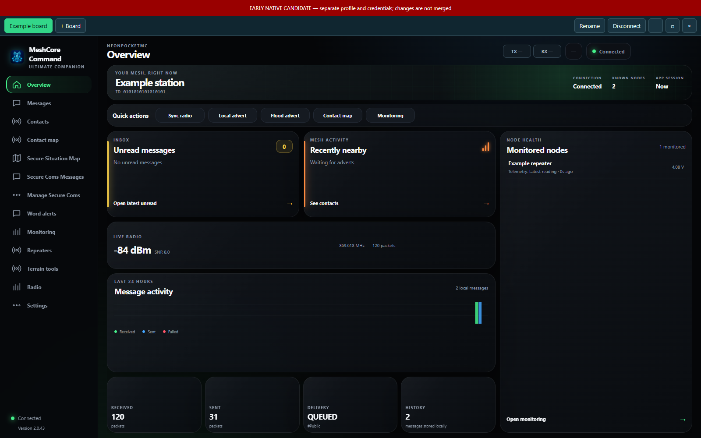

## Messages

Channels, direct conversations and rooms.

## Channel message actions

Right-click a channel message to find an existing contact or import a contact card.

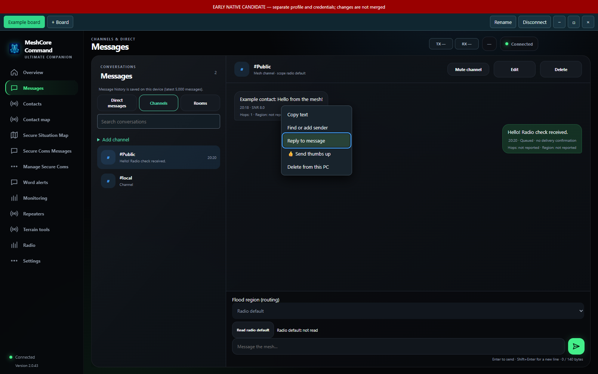

## Contacts

Search discovered nodes and inspect contact details.

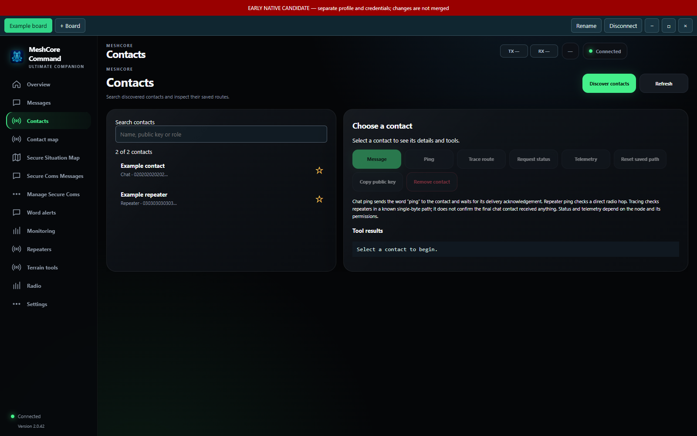

## Contact map

Display the last known advertised locations.

## Secure Situation Map

Use the floating toolbar for markers, areas, sharing and waypoints.

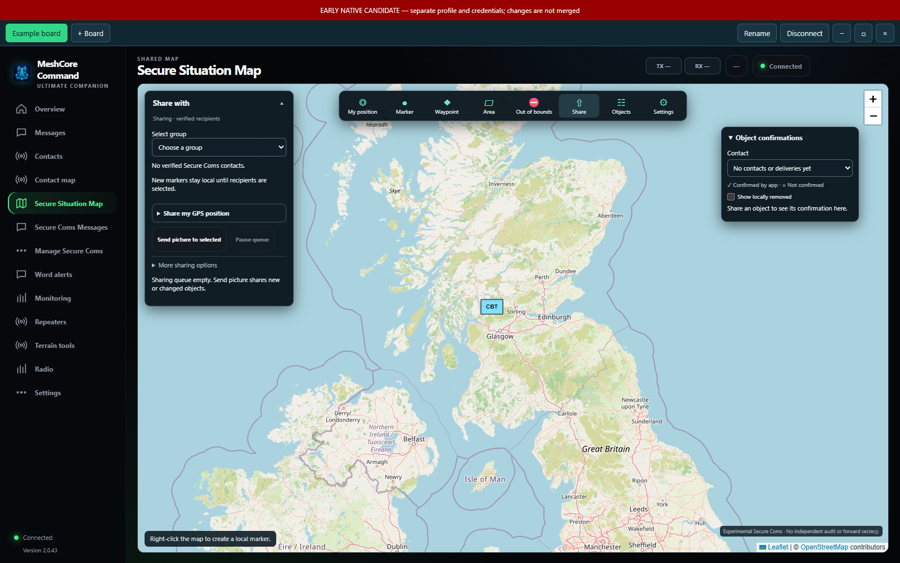

## Secure Coms Messages

Communicate with verified contacts or local groups.

## Secure message length

An inline warning explains when a message exceeds the 74-byte limit.

## Manage Secure Coms

Manage shared secrets and local recipient groups.

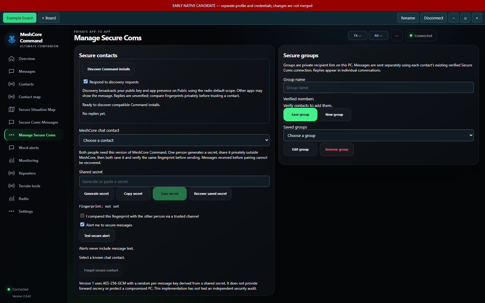

## Word alerts

Configure alerts for words seen in messages.

## Monitoring

Review example telemetry and voltage history.

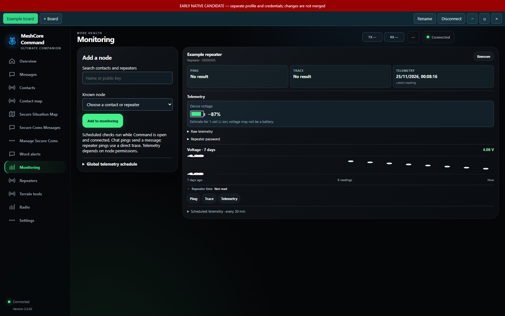

## Repeaters

Select a repeater and inspect its management views.

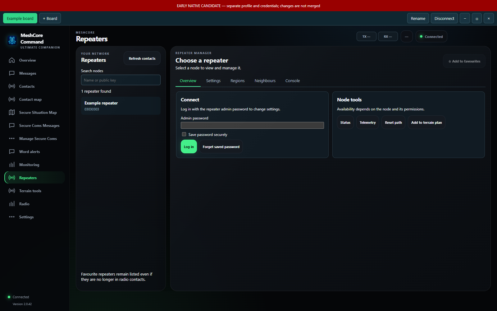

## Terrain tools

Plan sites, links and estimated terrain visibility.

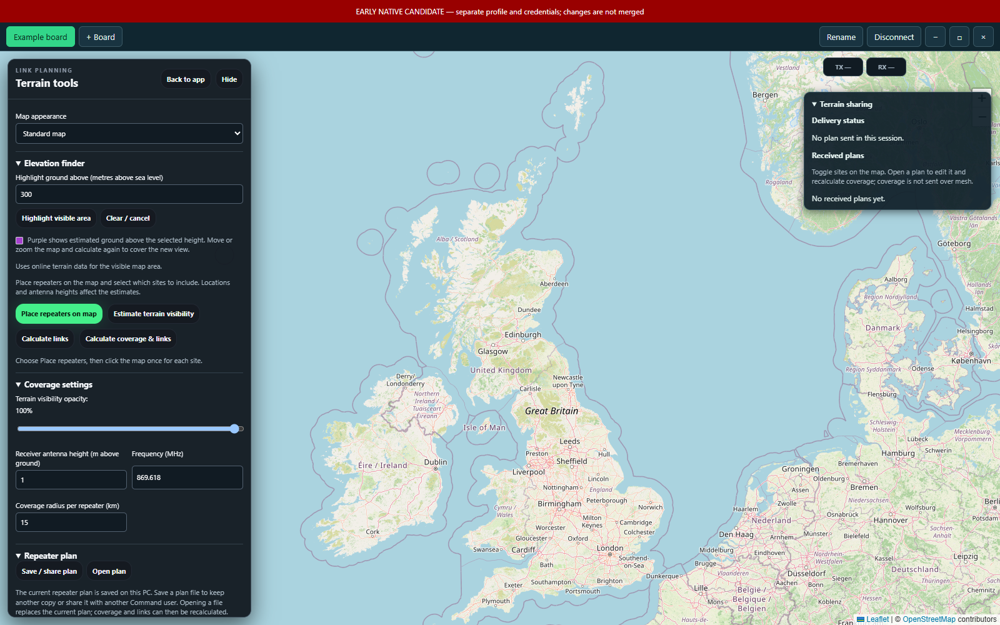

## Radio

Review radio settings and observed packet activity.

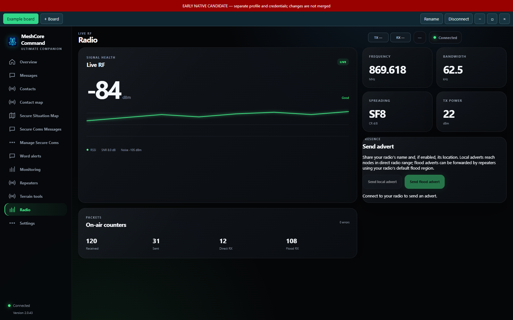

## Settings

Configure the connected radio, updates and backups.

