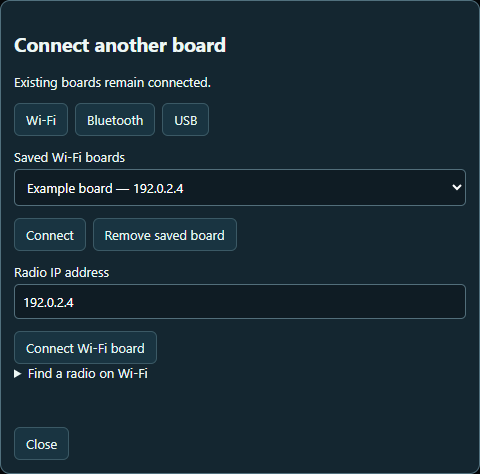
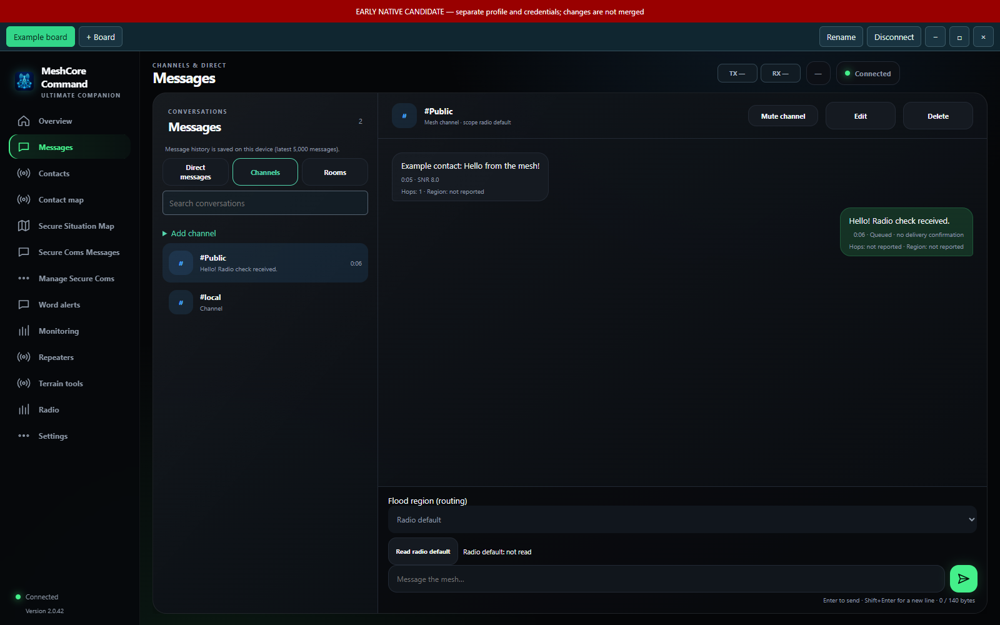
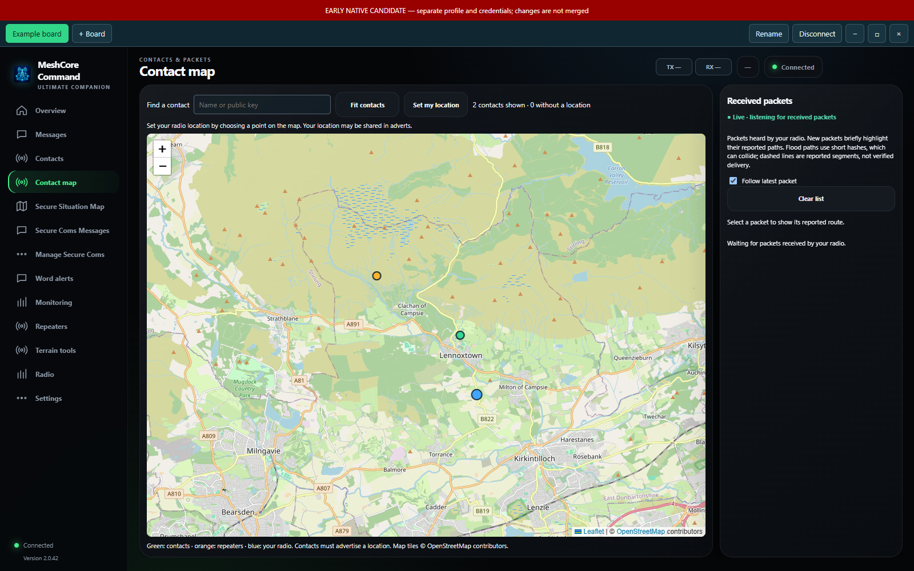
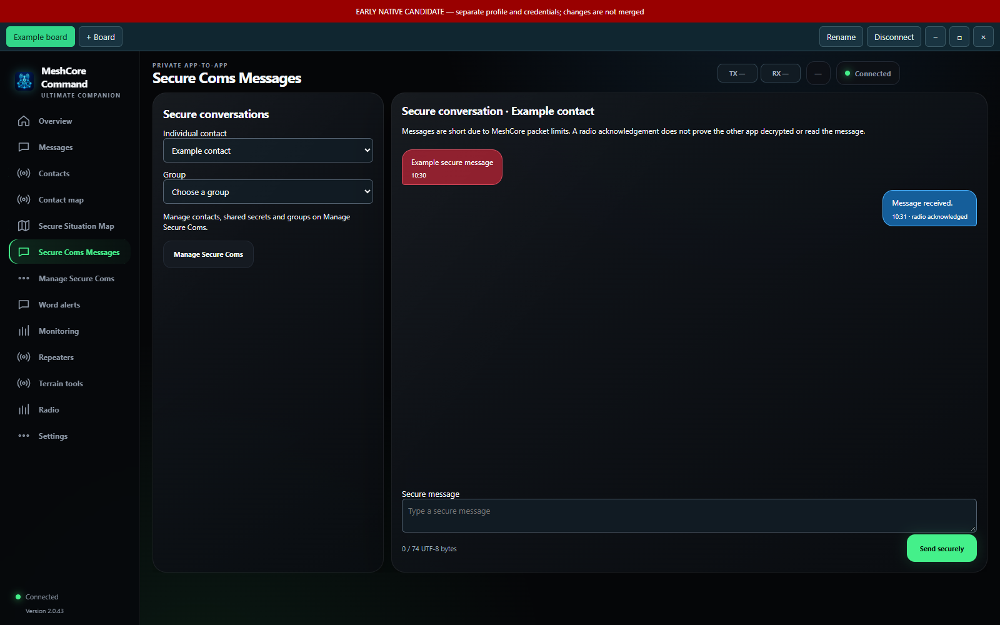
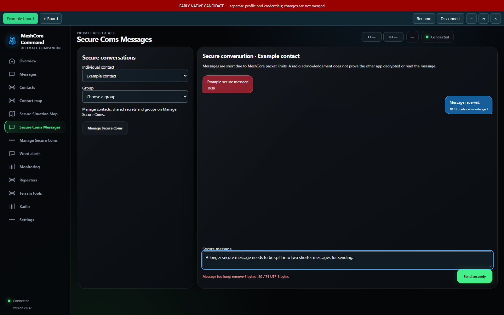
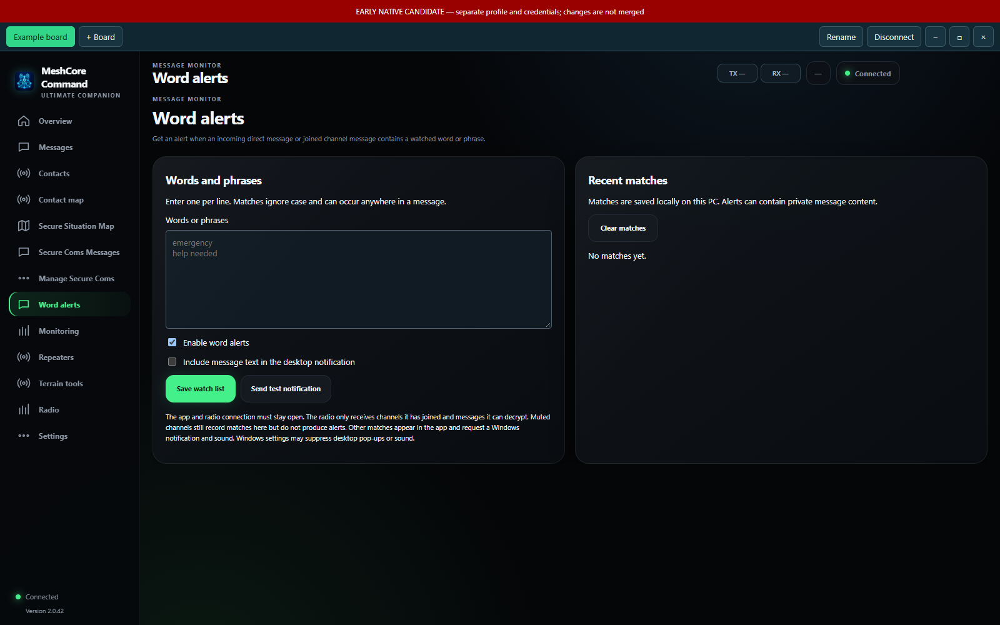
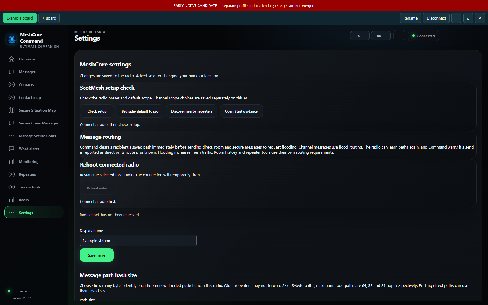

# MeshCore Command screenshots

These images show the native Windows 2.0.43 interface with simulated contacts, messages, telemetry and map objects. They were generated without connecting a radio or reading a user profile. The released 2.0.43 app still displays the red early-candidate banner shown here. Map data © OpenStreetMap contributors.

The native firmware dialog is not pictured here. The Android images in the README use the HTML from the released Android 0.2.15 APK with a simulated bridge; they are not photographs of a phone or live radio session.

## Saved Wi-Fi boards

Choose a saved board and connect beneath the list. Removing one requires confirmation.

## Overview

Radio status, recent activity and monitored nodes.

## Messages

Channels, direct conversations and rooms.

## Channel message actions

Right-click a channel message to find an existing contact or import a contact card.

## Contacts

Search discovered nodes and inspect contact details.

## Contact map

Display the last known advertised locations.

## Secure Situation Map

Use the floating toolbar for markers, areas, sharing and waypoints.

## Secure Coms Messages

Communicate with verified contacts or local groups.

## Secure message length

An inline warning explains when a message exceeds the 74-byte limit.

## Manage Secure Coms

Manage shared secrets and local recipient groups.

## Word alerts

Configure alerts for words seen in messages.

## Monitoring

Review example telemetry and voltage history.

## Repeaters

Select a repeater and inspect its management views.

## Terrain tools

Plan sites, links and estimated terrain visibility.

## Radio

Review radio settings and observed packet activity.

## Settings

Configure the connected radio, updates and backups.

